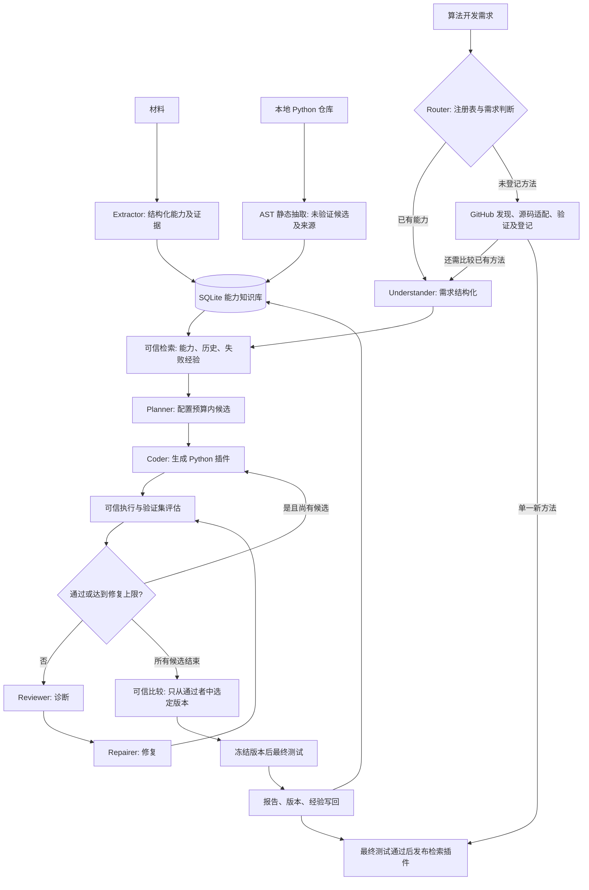

# 架构、角色与执行边界

## 两种请求

工厂请求：“为中文技术记忆生成检索算法”，输出代码、依赖、版本和验证报告。
插件请求：“以前怎么处理 MySQL 连接池耗尽”，输入记忆列表，输出记忆 ID、得分和来源。
两者分别对应 CLI 的 `run` 和 `query`。生成的 `retrieve` 插件可以独立用于未来个人记忆系统。

## 模块分工

| 模块 | 文件 | 工作 |
| --- | --- | --- |
| 输入与界面 | cli.py、models.py | CLI、参数和结构化契约校验 |
| 自动路由 | routing.py | 模型意图与原文名称检查、注册表匹配、复用/发现选择及发现后的候选比较 |
| 插件契约 | registry.py、plugins/ | 可信包发现、版本及依赖声明、阈值预检、算法与指标注册 |
| 模型适配 | llm.py | Ollama 原生 chat、JSON schema、一次重试、调用记录、明确的 mock 模板模式 |
| 能力知识 | knowledge.py | 材料抽取、原文证据检查、SQLite 版本存储、词面检索及图遍历 |
| 仓库证据 | repository.py | 不执行源码的 AST 抽取、函数/依赖/行号与哈希、人工关联、未验证候选入库 |
| 新算法发现 | github_sources.py、discovery.py | 实际 GitHub 搜索、固定提交下载、来源证据校验、无内置模板的源码适配 |
| 自动登记 | releases.py | 验证及最终测试通过后保存数据清单、代码哈希、来源许可，原子启用并供后续注册表加载 |
| 编排 | workflow.py | LangGraph 状态、角色交接、分支、修复预算、冻结候选与结果回写 |
| 执行边界 | safety.py、runner.py、worker.py | AST 策略、无标注输入、限时进程、Docker 隔离选项 |
| 修复支持 | repair.py | 专属上下文、可信失败定位、AST 进展检查、哈希校验的历史失败重放 |
| 可信验证 | validation.py | 输入数据检查、接口/功能/稳定性、注册指标（Recall/MRR/Precision/P95）、配置门槛 |
| 结果交付 | reporting.py、runtime.py、visualization.py | 报告、可复用插件适配器、图谱导出 |
| 业务接口 | api.py、jobs.py、job_worker.py | token 鉴权、输入限制、持久任务队列、租约与宿主 worker |

## Agent 工作流

每个角色使用独立提示与结构化输出，同一 Ollama 模型可以串行承担这些角色。
这是有明确交接的角色协作工作流，没有实现自治 Agent 间并发协商。
控制、检索、指标计算和发布决策由确定性代码负责。

仓库抽取是独立 CLI 入库步骤；同一 workspace 后续运行会检索关联候选。Planner 只收到函数概要，生成和修复角色最多收到当前算法一个限长源码参考。候选保持未验证，生成版本记录 `context_from` 来源边，仍须通过可信验证。扫描范围、字节/符号预算和边界见 [仓库抽取指南](repository-extraction.md)。

另有 `discover` 来源工作流：搜索规划 → 实际 GitHub 搜索 → 选库/固定提交下载 → AST → 方法提议 → 源码适配生成 → 原统一验证及有限修复 → 冻结最终测试 → 登记 → 回写。该路径不需要已有算法 ID，不传入内置模板，不直接安装下载库；已登记的方法随后回到普通 `run` 的候选目录。详见 [发现与登记](github-discovery.md)。

每个候选默认初版+最多两次修复；每次模型调用最多两次尝试。
Web、CLI `run` 与工厂 API 默认自动选择路径。混合请求保存独立的发现和比较报告，通过 `discovery_run_id` 关联；比较保留本次验证策略。详见 [自动路由](automatic-routing.md)。
LangGraph 递归上限提供额外终止保护。所有候选失败时出失败报告，不生成成功插件。
最终测试失败只报告失败，不继续调参、修复或重新选候选。

候选按配置 selection_order 与指标 direction 比较；同分时依次考虑依赖数、配置算法顺序和修订次数。算法清单、指标计算与报告标签来自注册表，插件版本随产物与知识回写记录。详见 plugins.md。
P95 是合格门槛，避免用单次小样本计时噪声决定候选优劣。
所有版本和错误保留，不覆盖旧代码；报告记录代码、数据和依赖版本。
调用记录和流程事件可审计；本版不实现中断后恢复执行的持久化检查点。

## 执行边界

生成模块不接收相关 ID 标注，只有 query/memories/top_k；可信父进程保留标注并计算指标。
Docker 镜像只放入执行器与算法依赖，不挂载项目目录、密钥、知识数据库或测试文件。
执行关闭网络、降为非 root、只读根文件系统、丢弃 capabilities，并限制内存、CPU、进程数与总时长。
AST 白名单和受限 builtins 是额外防护，不是 Python 安全性的形式证明。
Docker 共用宿主内核，不等同于独立虚拟机；生产场景可升级到专门的隔离执行服务。

mock 默认 local，为可查看的仓库模板提供简单复现。local 使用独立进程、清理环境、超时与资源限制，
仍不能可靠阻止恶意代码接触宿主资源。真实模型默认 Docker，使用 local 必须显式 `--allow-local`。
LLM 不能更改验证器、数据标注、阈值或发布条件。模型服务错误不会自动伪装成 mock 成功。

新生成只传入当前算法能力；错误行及参考实现参与审查，重复实现被拒绝，最后一轮从参考示例重新复刻。公开算法契约检查具体评分公式。详情见 generation-repair.md。

## Web 与分组评估

web/ 的静态页面通过鉴权任务 API 提交需求；JobStore 为领取后的任务关联 run_id，网页轮询可信执行阶段。下载接口限定文件及目录范围，生成的文字只作为文本展示。serve_web.py 同时启动网关和 worker，二者使用同一 workspace。

Query 新增 category、hard_negative_ids 和 annotation。负例在真实检索语料中参与检索；评分器独立检查标签，计算分组指标与漏召回/排序/负例混淆诊断。生成执行器继续只接收 query、无标注 memories 与 top_k，诊断分组不是新的验收门槛。
