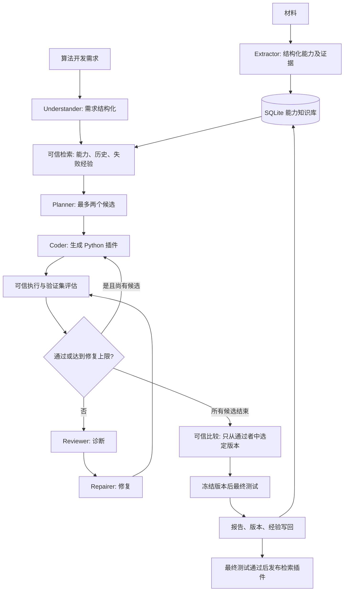

# 架构、角色与执行边界

## 两种请求

工厂请求：“为中文技术记忆生成检索算法”，输出代码、依赖、版本和验证报告。
插件请求：“以前怎么处理 MySQL 连接池耗尽”，输入记忆列表，输出记忆 ID、得分和来源。
两者分别对应 CLI 的 `run` 和 `query`。生成的 `retrieve` 插件可以独立用于未来个人记忆系统。

## 模块分工

| 模块 | 文件 | 工作 |
| --- | --- | --- |
| 输入与界面 | cli.py、models.py | CLI、参数和结构化契约校验 |
| 模型适配 | llm.py | Ollama 原生 chat、JSON schema、一次重试、调用记录、明确的 mock 模板模式 |
| 能力知识 | knowledge.py | 材料抽取、原文证据检查、SQLite 版本存储、词面检索及图遍历 |
| 编排 | workflow.py | LangGraph 状态、角色交接、分支、修复预算、冻结候选与结果回写 |
| 执行边界 | safety.py、runner.py、worker.py | AST 策略、无标注输入、限时进程、Docker 隔离选项 |
| 可信验证 | validation.py | 输入数据检查、接口/功能/稳定性、Recall/MRR、P95、固定门槛 |
| 结果交付 | reporting.py、runtime.py、visualization.py | 报告、可复用插件适配器、图谱导出 |
| 业务接口 | api.py、jobs.py、job_worker.py | token 鉴权、输入限制、持久任务队列、租约与宿主 worker |

## Agent 工作流

每个角色使用独立提示与结构化输出，同一 Ollama 模型可以串行承担这些角色。
这是有明确交接的角色协作工作流，没有实现自治 Agent 间并发协商。
控制、检索、指标计算和发布决策由确定性代码负责。

每个候选默认初版+最多两次修复；每次模型调用最多两次尝试。
LangGraph 递归上限提供额外终止保护。所有候选失败时出失败报告，不生成成功插件。
最终测试失败只报告失败，不继续调参、修复或重新选候选。

候选优先比较验证 Recall@k，再比较 MRR@k；完全相同时选择外部依赖更少的 BM25。
P95 是合格门槛，避免用单次小样本计时噪声决定候选优劣。
所有版本和错误保留，不覆盖旧代码；报告记录代码、数据和依赖版本。
调用记录和流程事件可审计；本版不实现中断后恢复执行的持久化检查点。

## 执行边界

生成模块不接收相关 ID 标注，只有 query/memories/top_k；可信父进程保留标注并计算指标。
Docker 镜像只放入执行器与算法依赖，不挂载项目目录、密钥、知识数据库或测试文件。
执行关闭网络、降为非 root、只读根文件系统、丢弃 capabilities，并限制内存、CPU、进程数与总时长。
AST 白名单和受限 builtins 是额外防护，不是 Python 安全性的形式证明。
Docker 共用宿主内核，不等同于独立虚拟机；生产场景可升级到专门的隔离执行服务。

mock 默认 local，为可查看的仓库模板提供简单复现。local 使用独立进程、清理环境、超时与资源限制，
仍不能可靠阻止恶意代码接触宿主资源。真实模型默认 Docker，使用 local 必须显式 `--allow-local`。
LLM 不能更改验证器、数据标注、阈值或发布条件。模型服务错误不会自动伪装成 mock 成功。
