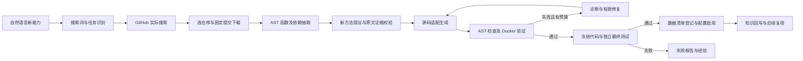

# 从 GitHub 发现并登记新检索算法

`run` 使用已登记的能力材料和参考实现；`discover` 为当前能力目录增加一个新检索方法。后者自动搜索公开仓库、下载固定提交源码、静态抽取、生成适配代码，经过统一验证后登记。无需先手工编写 `plugins/*.py` 或新算法模板。

这里的“新”是本工厂尚未登记的方法，通常是复刻已有开源算法，并不表示发明新算法。当前执行契约仍为 `memory_retrieval`；文本分类、预测等任务需要增加对应数据、接口和验证器。外部方法若无法适配当前依赖与安全规则，会明确失败。

## 运行

Ollama 模型可部署在 Jetson，工厂、GitHub 网络请求和 Docker 在 Mac。保持现有 11435 隧道即可；命令不会主动 SSH 到远端。

```bash
cd ~/Downloads/agent-factory
docker build -f Dockerfile.runner -t agent-factory-runner:0.1 .

.venv/bin/python -m agent_factory --verbose discover \
  --provider ollama --model qwen3.5:2b \
  --base-url http://127.0.0.1:11435 \
  --description '为中文与英文混合技术笔记检索发现尚未登记的 BM25Plus 方法。自动搜索 GitHub 中的算法实现库，保留源码评分公式与默认参数，适配 retrieve(query, memories, top_k=5)，验证合格后登记。'

# 查看自动增加的算法名称、版本和来源
.venv/bin/python -m agent_factory plugins
```

发现流程需要真实 Ollama 和 GitHub 网络访问。通常无需 GitHub 令牌；遇到 API 配额限制可以在进程环境设置 `GITHUB_TOKEN`。令牌仅发送给 `api.github.com`，不进入模型上下文或报告，也不发送给源码下载域名。

已有方法不会通过改名重复登记。再次演示 BM25Plus 时可使用新的独立 workspace，复制 `data/`、`knowledge/sources/` 和三算法基线 `config.json`，避免污染已有能力与历史。指定 `--workspace` 必须放在 `discover` 之前。

## 工作流与模块



- `github_sources.py`：搜索、许可筛选、提交锁定、源码归档读取与下载预算。
- `repository.py`：现有 AST 抽取器，提取未验证的语法证据，不导入目标模块。
- `discovery.py`：搜索、选库、方法提议、生成和修复的角色工作流；复用原统一验证器与最终测试。
- `retrieval_scaffold.py`：复用算法无关的分词、词频/文档统计、空输入处理及排序；不含算法评分公式。
- `releases.py`：经过验证的版本清单、文件哈希、来源许可保留和原子登记。
- `registry.py`：加载内置可信插件与 workspace 中已批准的数据清单；生成的登记代码不会被动态导入。

搜索最多三个词组：精确方法词搜索 README，较宽泛的家族词搜索仓库名，再按名称、描述相关性及 stars 排序。模型只能选择实际结果中的仓库。下载不满足边界时最多尝试三个实际候选，不编造搜索结果或偷偷回退模板。

源材料和模型归纳均可能有误。提议名称须在来源证据中出现，引用须为下载文件的连续原文。生成角色以实际评分函数和构造参数为依据，只接收限长源码证据，不接收内置 `templates/bm25.py`、测试集查询或相关性标注。保留评分方法，同时将接口及分词适配为工厂契约；并非直接安装和运行整个外部库。

为减轻小模型反复编写分词及接口的负担，新流程采用组合生成：模型生成 `score_document(query_terms, document_terms, corpus_stats)` 评分函数，框架提供 `Counter` 形式的查询/文档词频、文档数量、平均长度及文档频次，再组合成完整独立 `retrieve` 代码。模型不得覆盖框架名称，最终组装代码仍完整接受 AST 和 Docker 验证。它限制了本版可发现的方法为能使用这些统计量实现的词面检索算法；并非任意外部库均能自动适配。

来源函数若具有 `tf` / `tf_array` 参数，使用数值契约 `score_term(tf, df, doc_len, avg_len, N)`。框架负责按查询词聚合，模型只复刻来源中的词频及逆文档频率评分，不把 `Counter` 容器误当成数值数组。这个适配依据源码参数形态，不靠 BM25Plus 名称选择内置公式。不能表达为这种聚合方式的方法需要扩展契约；源码约定不匹配时验证仍可能失败。

当来源存在受支持的简单标量 TF/IDF 函数时，框架用受限 AST 算术解释器推导公开数值样例，检查出现/未出现词及重复查询词的分数。解释器只识别数字、已绑定变量、四则运算和明确允许的 math 函数，不导入模块或执行仓库函数；不支持的语法明确记录为 unsupported，不猜测公式。样例作为 `AlgorithmSpec.public_cases` 进入统一验证器，并随登记清单保存。它曾检测到“指标通过但漏掉 delta”的错误，实现由此被撤销并重新验证。少量样例仍不等于完整数学等价性证明。

对这种受支持的纯算术源码，框架同时通过 AST 重命名生成独立评分核和参数映射提示；模型可调用这些评分核或返回等价的数值实现，统一检查负责发现公式遗漏。评分核来自本次下载的源码，未预置 BM25Plus 模板。完整产物由“通用接口＋静态适配的外部评分核＋模型生成的适配函数”组合，并接受统一检查；没有拿内置算法代码替换失败的模型响应。外部模块、安装脚本与装饰器仍不会被直接执行。

模型 JSON/代码生成失败也会作为失败版本进入修复循环。最多两次算法修复；第二次重新根据来源生成。审查意见保留为未经验证的建议，不能覆盖实际错误、源码公式或安全规则。最终测试失败后不再修复或重新选择。

Qwen3.5 在贪心采样下曾反复生成重复赋值，耗尽输出预算；该失败原始响应仍留在本地运行历史。当前对 `qwen3.5` 的代码生成/修复角色使用[模型官方非思考文本参数](https://huggingface.co/Qwen/Qwen3.5-2B)：temperature=1、top_p=1、top_k=20、min_p=0、presence_penalty=2、Ollama repeat_penalty=1，并设置 seed=42。其他结构化角色保持温度 0，避免搜索词变成过长的创作描述。来源评分函数预算为 1024 输出 token，完整参考复刻仍为 4096；所有实际参数写入 `llm/*.json`。固定 seed 便于追踪，不保证跨硬件或模型版本逐字一致。

## 产物与复用

每次发现的 `runs/<run_id>/` 包含：

| 文件 | 含义 |
| --- | --- |
| `search_results.json`、`download_attempts.json` | 实际搜索结果和下载候选的拒绝记录 |
| `repository/github-snapshot.json`、源码和 LICENSE | 固定提交、许可、文件原始字节哈希；保留范围内的源码快照 |
| `extracted_repository.json`、`source_context.json` | AST 抽取结果与实际传给模型的证据范围 |
| `proposal.json`、`plan.json` | 新方法提议、原文引用与适配方案 |
| `source_contract.json` | 从支持的源码公式推导的公开数值检查，或无法推导的明确原因 |
| `<algorithm>/r0..r2/`、`llm/` | 生成版本、真实诊断、验证和模型原始响应 |
| `selected_retrieval.py`、`plugin.json` | 最终通过的可调用代码与执行清单 |
| `report.json`、`report.md`、`knowledge/` | 指标、冻结测试结果、登记信息与图谱 |

只有验证集和最终测试均通过，才写入：

```text
state/algorithm_registry/<algorithm_id>/<run_id>/
  manifest.json        # 名称、来源提交、依赖、版本及哈希
  reference.py         # 已通过的生成代码
  material.md          # 由来源证据形成的能力材料
  verification.json    # Docker 验证和最终测试证据
  source-licenses/     # 原始来源许可文件
state/algorithm_registry/active.json
```

登记后重新加载注册表即可发现新方法。未超过八个启用候选时，系统自动更新 workspace 的 `config.json`；达到候选上限时仍保留登记，但不自动启用。后续 `run` 从能力图谱或材料检索它，把已验证代码作为参考，再生成和比较；`query --run <run_id>` 则直接调用已产出的插件。

注册目录与运行状态不提交 Git。可审查的真实示例单独归档到 `examples/github-discovery-demo/`。文件哈希检查可以发现意外修改，假定宿主和工作目录由可信操作者管理。

## Web / API

以 `--provider ollama --runner docker` 重新启动 Web 服务后，勾选“从 GitHub 发现新算法”，再填写能力描述。网页展示搜索、下载、AST、生成、验证与登记阶段，以及来源仓库、提交和报告下载。离线模式禁用发现入口。

鉴权 API：`POST /v1/algorithms/discover`，请求体 `{"description":"..."}`，返回异步 `job_id`；沿用 `/v1/jobs/{id}` 轮询和 `/v1/runs/{run_id}/report`。不提供任意文件下载：额外允许下载搜索结果、提议和抽取结果 JSON。

## 当前边界

只接受公开 Python 仓库以及 MIT、Apache-2.0、BSD-2/3-Clause、ISC、0BSD、Unlicense、CC0-1.0 许可。固定提交归档压缩上限 20 MiB、展开上限 40 MiB / 4000 条目；保留源码上限 200 文件 / 5 MiB、单文件 256 KiB。拒绝路径穿越、链接与特殊文件。不会运行仓库安装脚本、装饰器、测试或自动安装依赖。

通过指标表示当前模拟数据与门槛上的通过；不保证所有语料效果，也不构成算法数学等价性的独立证明。方法身份与公式仍应审查源码、模型输出和报告。依赖范围为当前执行镜像中的标准库和已允许 sklearn 模块；跨任务、额外依赖或 GPU 方法需要扩展可信环境。

## 已验证示例

[完整报告](../examples/github-discovery-demo/report.md)、[来源公式检查](../examples/github-discovery-demo/source_contract.json)、[实际模型调用](../examples/github-discovery-demo/llm/)、[最终代码](../examples/github-discovery-demo/selected_retrieval.py)、[批准的登记清单](../examples/github-discovery-demo/approved_registry/github_bm25plus/20261014T104638_183b968d/manifest.json)。

运行 `20261014T104638_183b968d` 实际搜索到 `xhluca/bm25s`，下载 MIT 许可固定提交，保留 77 个来源文件。真实 qwen3.5:2b 调用 7 次，首次生成数值不符，r1 修复后通过公开公式检查、36 条验证及 30 条最终测试，自动登记并启用。最终 Recall@5=0.9667、MRR@5=0.9250、Precision@5=0.2467、P95=4.03 ms。

随后[复用工作流](../examples/github-reuse-demo/report.md)使用 mock + Docker，再次生成比较全部四个已启用方法，新方法正常加载并通过验证。这个复用检查使用模板响应，不冒充第二次真实模型生成。Chrome 检查见 [浏览器记录](../examples/github_discovery_web_validation.json)，验证来源、报告、下载哈希与布局，检查期间没有提交新的模型任务。

真实运行在隔离 workspace `state/github-discovery-final-20261014`；默认目录配置未修改。在该目录后续提交普通 `run` 会包含四个方法。在默认目录使用 `discover` 会将结果登记到默认目录。
