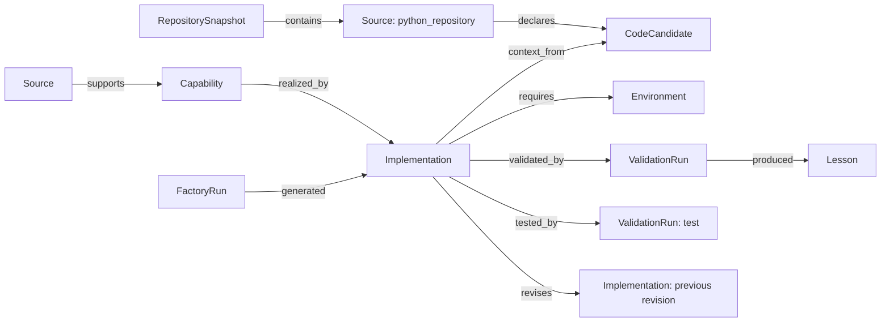

# 算法能力知识图谱 schema v1.1

SQLite 是持久化事实源，NetworkX 从表载入有向图，导出 JSON、GraphML 和离线 HTML。
能力知识与未来的个人事实/关系图谱分开。示例笔记是被检索的数据，并非能力知识节点。

## 实体

| kind | 标识 | 主要字段 |
| --- | --- | --- |
| Source | source_内容SHA256 | path、text、sha256 |
| RepositorySnapshot | repo_snapshot_扫描内容哈希 | repository_key、git_commit、include、limits、source_ids、candidate_ids、issues、limited；仅静态扫描 |
| CodeCandidate | code_candidate_抽取内容哈希 | qualified_name、signature、parameters、return_annotation、docstring、comments、imports、source_id、行号、file_sha256、code_sha256、algorithm、status=unvalidated |
| Capability | 算法名_抽取内容哈希 | name、task、algorithm、inputs、outputs、applicable_conditions、metrics、dependencies、limitations、source_id、evidence、algorithm_plugin_version |
| Implementation | 运行ID+算法+修订号 | code_hash、code_path、revision、parent、capability_id、explanation |
| Environment | environment_环境哈希 | Python、操作系统、依赖版本、执行器、Docker 镜像名 |
| ValidationRun | 运行ID+算法+版本/最终测试 | split、passed、metrics、errors、gates、per_query、execution、metric_plugins |
| Lesson | 运行ID+算法+修订/审查 | scope、algorithm、summary、validated_fix、evidence/repair_instructions |
| FactoryRun | run_运行ID | request、plan、attempts、selected、test、status、dataset_hashes、environment、plugin_catalog |

## 关系

所有节点不可覆盖：同一个 ID 的不同属性会报错。材料、抽取结果或算法插件版本变更产生新能力版本。执行产物 manifest 另保存 algorithm_plugin（含版本、环境及依赖）；验证节点记录指标插件元数据。
`nodes(id, kind, payload)` 存 JSON 属性，`edges(source, target, relation)` 以三列唯一并启用外键。
图中同一实体对只使用一种关系，因此 NetworkX DiGraph 能保留当前 schema 的全部关系。
新增并行关系时需迁移到 MultiDiGraph，不应让导出静默丢失边。

检索先对能力属性做字符 TF-IDF 排序，再沿图搜索相关实现、验证与经验。
在线 Agent 只读取验证集历史；最终测试报告保留在图谱用于审计，不作为后续修复反馈。
经验区分未经验证的审查建议和修复版本通过验证的事实。通过只表示当前数据及门槛上的通过。

抽取字段由 Pydantic 验证，source_id 必须指向本次材料，evidence 必须是原文连续片段。
这保证证据存在，但不能自动证明所有归纳字段在语义上正确；真实模型模式应人工抽查抽取样例。

上述 Pydantic/evidence 校验针对 LLM 材料抽取。仓库抽取由 Python AST、tokenize 直接产生事实字段，不执行或导入目标模块。仓库 Source 使用 `repo_source_` 前缀，包含仓库标识、相对路径与文件原始字节哈希；注释、签名、依赖只是语法证据。Git HEAD 是来源元数据，实际扫描版本以内容哈希为准，不承诺工作树干净。

`CodeCandidate` 与经过材料抽取的 `Capability`、经过执行验证的 `Implementation` 分开。只有操作者显式指定 `--algorithm` 才能进入对应算法的知识检索；该关联不认证正确性，也不注册插件。Planner 收到概要，Coder/Reviewer/Repairer 只收到当前算法至多一条有大小上限的源码摘录。生成版本通过 `context_from` 记录曾收到的参考节点；这条边不证明模型采纳了代码，也不会将候选的 `unvalidated` 状态改成通过。

详情与扫描限制见 [仓库抽取指南](repository-extraction.md)。

抽取结果见 `knowledge/extracted_capabilities.json`；带验证历史的图见 `examples/demo/knowledge/graph.json`。
